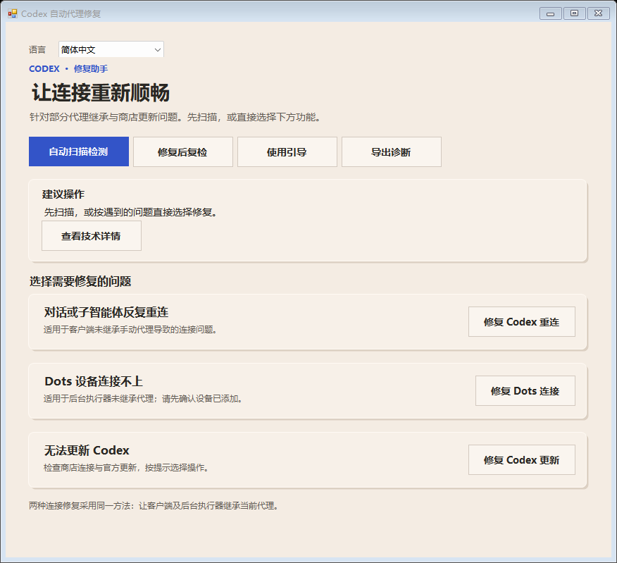
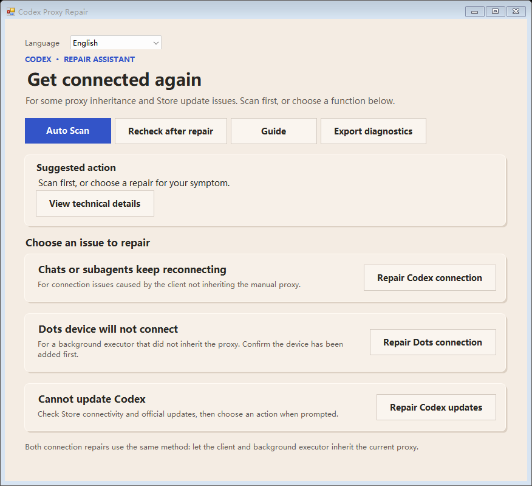
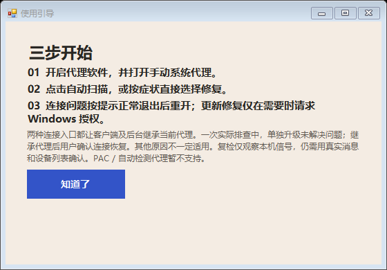
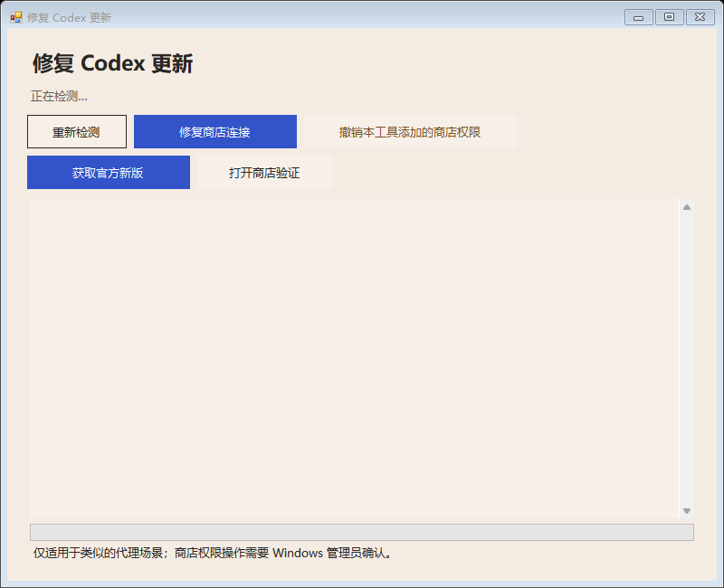

# Codex 自动代理修复

面向 Windows 官方 Store 版 Codex 的代理连接辅助工具。自动读取当前手动系统代理，为 **Codex 重连、Dots 连接和更新修复** 提供三个独立入口，并通过只读扫描帮助判断下一步。

[English](README.en.md) · [下载最新版](https://github.com/shangguanyiyu0011/codex-proxy-repair/releases/latest) · [排查指南](docs/TROUBLESHOOTING.md) · [更新记录](CHANGELOG.md)



适用于代理软件已开启、浏览器可访问，但 Codex 或 Dots 可能未继承代理的类似情形。它是独立第三方工具，与 OpenAI 无隶属关系；不保证适用于所有网络故障。

## 下载

当前版本 **v1.2.0**。Windows 10/11 x64，使用 Windows PowerShell 5.1 和系统 .NET Framework。

| 文件 | 用途 |
| --- | --- |
| [独立 EXE](https://github.com/shangguanyiyu0011/codex-proxy-repair/releases/latest/download/codex-proxy-repair-v1.2.0-windows.exe) | 直接打开，推荐入口 |
| [便携完整包](https://github.com/shangguanyiyu0011/codex-proxy-repair/releases/latest/download/codex-proxy-repair-v1.2.0-windows-portable.zip) | EXE 与随附说明 |
| [脚本与完整源码](https://github.com/shangguanyiyu0011/codex-proxy-repair/releases/latest/download/codex-proxy-repair-v1.2.0-script-source.zip) | Windows PowerShell 5.1 备用入口、本地构建 |
| [SHA256SUMS.txt](https://github.com/shangguanyiyu0011/codex-proxy-repair/releases/latest/download/SHA256SUMS.txt) | 下载文件校验值 |

EXE 尚无代码签名，Windows 可能显示未知发布者提示。未安装自签名信任证书；可先核对校验值与源码，并按 Windows 或组织的安全策略处理提示。

## 四步使用

1. 在代理软件中开启 **手动系统代理**。仅浏览器扩展代理不够。
2. 打开 EXE，或完整解压源码包后运行 `启动脚本版.cmd`。
3. 点击 **自动扫描检测**，查看建议；也可直接使用下列独立入口。执行连接启动前，先保存工作并正常退出 Codex，包括托盘中的进程。
4. 按建议操作后，在 Codex 中实际发送一条消息；使用 Dots 时再检查设备列表并尝试实际任务。

| 入口 | 做什么 |
| --- | --- |
| Codex 重连 | 按当前官方包身份，通过读取到的代理启动客户端；检测到 Codex 仍在运行时提示正常退出，不强杀进程。 |
| Dots 连接 | 为相关连接提供代理启动入口；不创建配对，不替代账户或设备授权。 |
| 更新修复 | 检查 Store 连接权限，或获取并验证官方 x64 新版包后提交更新。 |
| 自动扫描 / 分级复检 | 读取代理、包状态、近期重试和设备握手信号，给出建议与不确定项。 |
| 撤销 / 导出诊断 | 撤销有归属凭据的工具新增项；将白名单诊断保存到本地文件。 |

## 多语言与界面

支持简体中文、繁體中文、English、日本語、한국어，即时切换并记住当前用户的选择。首次启动跟随 Windows 界面语言，其他语言默认 English。Windows 原生授权窗口与部分系统错误仍由系统决定语言。

<details>
<summary>查看英语界面、使用引导与更新窗口</summary>







更新窗口截图展示操作入口和说明，不能作为更新成功的证明。

</details>

## 支持范围与实际行为

- 需要已正常安装的官方 Store 版 Codex / 统一 ChatGPT 应用。工具动态检测官方包身份与版本，不固定国家节点、端口或某个客户端版本。
- 当前支持 Windows **手动 HTTP 系统代理**，包括提供 HTTP 入口的混合代理。PAC/WPAD、带账号密码的代理和未知协议暂不支持。
- 连接启动不修改系统代理或永久环境变量，不修改模型、账户和设备授权，不安装后台服务。
- Store 权限修复需要 Windows 管理员确认，仅在缺少时添加 Microsoft Store 的单项本机网络例外。工具用当前用户 DPAPI 保护归属记录，撤销只处理有凭据的工具新增项。
- 官方更新路线在下载后验证签名、发布者、包身份、x64 架构和版本，再调用 `Add-AppxPackage`。运行中的应用延后更新，不强制关闭。
- 诊断仅本地导出白名单字段，不包含原始日志、令牌、对话文本或完整命令行。运行状态、语言偏好与撤销凭据均按当前用户保存，不应跨电脑复制运行记录。

**复检通过仍需实际使用确认。** 零重试不证明真实消息成功，握手信号不证明 Dots 已完整恢复。扫描计数可能包括其他本地聊天；日志格式或包结构无法识别时保留未知状态。详见[排查指南](docs/TROUBLESHOOTING.md)。

## 从源码构建

完整源码为原生 .NET Framework WinForms 应用。构建脚本调用 Windows 自带的 C# 编译器，不下载第三方依赖。

在项目根目录的 **Windows PowerShell 5.1** 中运行：

```powershell
.\build.ps1
.\Start-Repair.ps1 -Mode SelfTest
```

EXE 输出：`build/Codex（自动代理修复）.exe`。EXE 自检可运行：

```powershell
& '.\build\Codex（自动代理修复）.exe' --self-test
```

本地构建流程可供审阅和重建，不承诺产物逐字节一致。源码入口见 [SOURCE-README.txt](SOURCE-README.txt)；组织策略限制脚本时，备用入口也可能受限。

## 验证情况

在开发电脑完成 EXE 与脚本版自检、五种语言的默认及最小窗口尺寸共 40 个界面渲染样本检查，以及实际日志显示切换检查。**尚未在另一台电脑进行实机验证**，不宣称覆盖所有代理软件、网络或客户端版本。

## 许可

项目源码采用 [MIT License](LICENSE)。系统组件、字体与品牌归属见 [THIRD_PARTY_NOTICES.md](THIRD_PARTY_NOTICES.md)。
